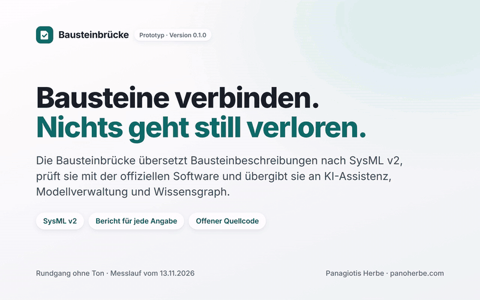

# Bausteinbrücke

**Bausteine eines Entwicklungsprojekts nach SysML v2 übersetzen und an KI-Assistenz, Modellverwaltung und
Wissensgraph übergeben, ohne dass etwas still verloren geht.** Nach jedem Lauf sagt ein Bericht für jede einzelne
Angabe, ob sie übernommen, umgewandelt, nicht abbildbar oder eine offene Referenz ist. Der Prototyp läuft heute.

**[▶ Vorführung im Browser öffnen](https://www.panoherbe.com/projekte/bausteinbruecke)** (ohne Installation) ·
[Video herunterladen (MP4)](medien/rundgang.mp4) · [Untertitel zum Nachlesen](medien/UNTERTITEL.md) · [Messbericht](nachweis/2026-11-13/BERICHT.md)



*Rundgang, 85 s, ohne Ton. Gezeigt wird die Vorführung mit den Ergebnissen des Messlaufs vom 13.11.2026.*

## Was Sie hier prüfen können

| Was ein Integrationsprojekt braucht | läuft hier schon (gemessen am 13.11.2026) |
|---|---|
| Bausteine nach SysML v2 bringen, mit **einer Regel je Bausteintyp** statt je Werkzeug | 6 Bausteine aus zwei Demonstratoren (Roboterarm, Flurförderfahrzeug); das Ergebnis ist in der offiziellen SysML-v2-Software der OMG gültig |
| **Nichts geht still verloren** | Der Bericht nennt jede der 101 Angaben mit Grund; nach dem Rückweg aus dem Werkzeug sind **99 von 99 Angaben** wieder da |
| **Identität und Versionen** über Werkzeuggrenzen | Version 1.2.0 → 1.3.0: genau die zwei geänderten Werte und der neue Zustand erkannt, nichts weggefallen. Das Werkzeug vergibt beim Einlesen neue interne Kennungen (nur 15 von 568 gleich); darum trägt die Brücke Baustein-ID und Version selbst |
| **Drei Anschlüsse** auf einem gemeinsamen Kern | KI-Assistenz (REST/JSON), Modellverwaltung (Stände mit Vorgänger), Wissensgraph (RDF, vor dem Senden mit SHACL geprüft) |
| **Störungen** werden sichtbar statt still (gegen nachgebildete Werkzeuge) | Werkzeug fällt aus → „offen“ im Protokoll, der nächste Lauf holt nach; Antwort geht verloren → **0 Dubletten**; paralleler Stand → Konflikt, nichts überschrieben; unbekannter Begriff → abgelehnt mit Grund |
| **Wiederholbare Tests** | 14 automatische Tests in 7,8 s, darunter das Testszenario „eine Bausteinänderung erreicht alle Werkzeuge“ |
| **Bewertung für kleine und mittlere Unternehmen** | abgeleiteter Bausteintyp: 7 Zeilen Regel; neue Gegenstelle: ein Adapter mit 12–16 Zeilen; Lizenzkosten 0 €; Wachstum bis 600 Bausteine gemessen (vervielfältigt, also simuliert) |

## In zwei Minuten selbst prüfen

1. **Ohne Installation:** die [Vorführung](https://www.panoherbe.com/projekte/bausteinbruecke) durchklicken (vier
   Schritte, etwa drei Minuten). Sie zeigt die aufgezeichneten Ergebnisse des Messlaufs; im Browser läuft kein Werkzeug.
2. **Lesen:** der [Messbericht vom 13.11.2026](nachweis/2026-11-13/BERICHT.md), die erzeugten SysML-Texte und das
   Übertragungsprotokoll im selben Ordner.
3. **Selbst laufen lassen** (Docker; nach dem Testlauf belegten Prüfdienst und Gegenstellen zusammen rund 1 GB
   Arbeitsspeicher, gemessen am 13.11.2026, [`speicher.txt`](nachweis/2026-11-13/speicher.txt)):

   ```bash
   docker compose up -d --wait pruefer gegenstellen   # offizielle SysML-v2-Software und nachgebildete Werkzeuge
   docker compose run --rm test                        # alle Tests, etwa 10 Sekunden
   docker compose run --rm messen                      # der ganze Messlauf, schreibt nachweis/<datum>/
   ```

## So funktioniert es

```
Bausteinbeschreibung (YAML, je Baustein und Version)
   │  Regel je Bausteintyp (bruecke/regeln/*.yaml)
   ▼
SysML v2 (Textnotation) ── Prüfung in der OMG-Pilotimplementierung ── Rückweg: jede Angabe im JSON-Export wiederfinden
   │                                                                     │
   ▼                                                                     ▼
gemeinsamer Kern: Prüfung vor dem Senden · Schlüssel gegen Dubletten · Wiederholung · Protokoll · Ampel
   │                         │                              │
   ▼                         ▼                              ▼
KI-Assistenz     Modellverwaltung        Wissensgraph
REST/JSON               Stände mit Vorgänger           RDF + SHACL
```

**Bericht:** Jede Angabe landet in genau einer von vier Spalten. *Übernommen* steht unverändert im Modell.
*Umgewandelt* steht im Modell, aber in anderer Form, mit Regel und Grund (Beispiel: eine Einheit ohne Gegenstück in
der Einheitenbibliothek). *Nicht abbildbar* bleibt in der Quelle, mit Grund (Beispiel: eine CAD-Datei).
*Offene Referenz* verweist auf etwas, das es im Ziel noch nicht gibt (Beispiel: eine Anforderung, die im
Anforderungsstand fehlt); sie wird gemeldet, nie erfunden.

**Ampel je Lauf:** grün, wenn alles übertragen ist; gelb, wenn alles da ist, aber mit gemeldeten Hinweisen; rot, wenn
mindestens ein Vorgang offen ist. Ein halbes Ergebnis zählt nie als Erfolg.

## Aufbau

| Ordner | Was darin liegt |
|---|---|
| [`bruecke/`](bruecke) | der Kern: `abbilden.py` (Regeln → SysML v2 und Bericht), `rueckweg.py`, `vergleich.py`, `kern.py` (Prüfung, Schlüssel, Wiederholung, Protokoll), `adapter.py` (die drei Anschlüsse), `regeln/`, `einheiten.py` |
| [`beispiele/`](beispiele) | erfundene Bausteinbeschreibungen von zwei Demonstratoren und der Anforderungsstand |
| [`pruefer/`](pruefer) | Prüf- und Exportdienst mit der OMG-SysML-v2-Pilotimplementierung (Jupyter-Kernel) |
| [`gegenstellen/`](gegenstellen) | die drei Werkzeuge, nachgebildet und gezielt störbar |
| [`tests/`](tests) | das Testszenario und die Störfälle |
| [`nachweis/`](nachweis) | Messläufe: Bericht, Ergebnisse, erzeugte Texte, Protokoll |
| [`demo/`](demo) | die Vorführung im Browser (eine Datei, ohne Netzanfragen) |
| [`medien/`](medien) | Rundgang als Video und GIF, Bilder |

## Was der Prototyp noch nicht ist

- Die drei Werkzeuge sind **nachgebildet**. In einem Projekt treten die echten Zugänge an ihre Stelle; der Kern bleibt,
  die Adapter werden an die vereinbarten Schnittstellen angepasst.
- Die Bausteine, Anforderungen und Begriffe sind **erfunden**. Die Regeln decken die Felder dieser Beispiele ab.
- Es gibt keinen Rückweg vom Werkzeug in die Quelle, keine Anmeldung und keine Rechteverwaltung.
- Gemessen ist auf einem Kleinrechner, nicht auf einem echten PLM- oder Graph-System.

## Technik

Python 3.13, PyYAML, rdflib, pySHACL, jsonschema; OMG SysML v2 Pilot Implementation (`jupyter-sysml-kernel`
0.63.1) im eigenen Container. Keine Datenbank, keine Cloud, keine Lizenzkosten. Arbeitsspeicher (gemessen 13.11.2026,
[`speicher.txt`](nachweis/2026-11-13/speicher.txt)): Prüfdienst frisch 0,6 GB, nach dem Testlauf knapp 1 GB, nach dem ganzen
Messlauf mit 600 Bausteinen 5,8 GB; Gegenstellen 31 MB.

## Lizenz

Quellcode: [AGPL-3.0](LICENSE). Die OMG-Pilotimplementierung steht unter EPL-2.0 und wird nur als Container genutzt.
Für Projekte sind andere Lizenzbedingungen nach Absprache möglich.

Panagiotis Herbe · [panoherbe.com](https://www.panoherbe.com)
